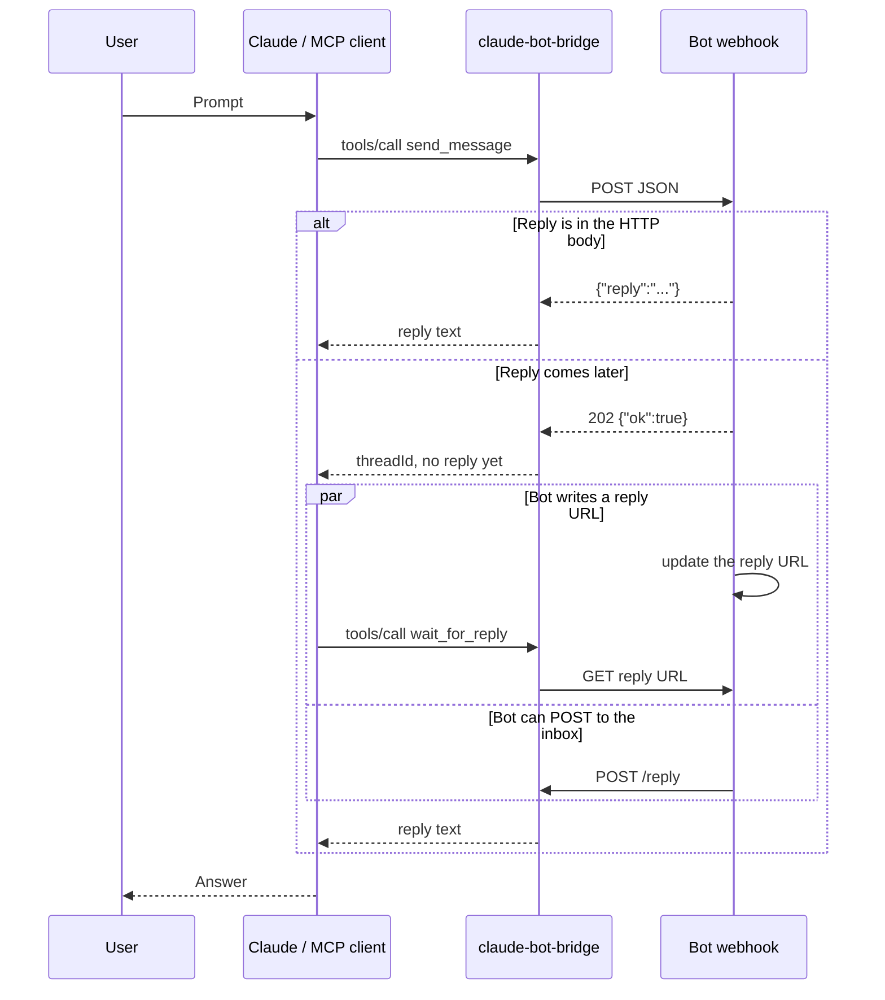
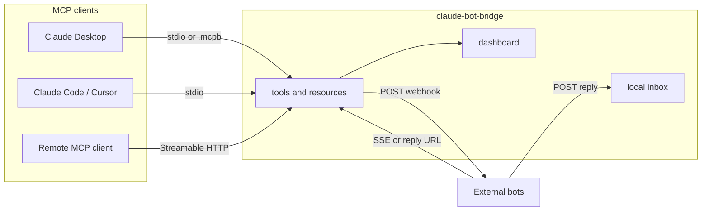

# claude-bot-bridge

[](https://github.com/SHAN-code5/claude-bot-bridge/actions/workflows/ci.yml)

MCP server that lets Claude Desktop, Claude Code, Cursor, and any other MCP client send a message to an external AI bot over an HTTP webhook, then read the reply.

The bot does not have to call Claude. It answers in the webhook response, writes a URL the bridge can poll, hosts an SSE stream the bridge connects to, or POSTs to a small inbox. Version 0.2 also installs from a Desktop Extension, runs `init` and `doctor`, relays two bots, and can listen as a remote MCP server.

Not affiliated with Anthropic. Claude is a trademark of its owner.





## Install without editing JSON

**Desktop Extension.** Build a one-click bundle and open it in Claude Desktop (double-click, or Settings → Extensions → Advanced → Install Extension):

```bash
node bin/claude-bot-bridge.js pack
```

That writes `claude-bot-bridge.mcpb`. The install form asks for the webhook URL and secret. The manifest is [`mcpb/manifest.json`](mcpb/manifest.json).

**Init.** This merges the server into the Claude Desktop config for macOS, Windows, or Linux:

```bash
npx claude-bot-bridge init --url https://example.com/webhook --key "$BOT_WEBHOOK_KEY" --name Assistant
```

Quit Claude Desktop fully, then open it again. `npx claude-bot-bridge` works after the package is published; until then use `node bin/claude-bot-bridge.js` or `npx github:SHAN-code5/claude-bot-bridge`.

**Doctor.**

```bash
BOT_WEBHOOK_URL=https://example.com/webhook BOT_WEBHOOK_KEY=secret node bin/claude-bot-bridge.js doctor
```

It sends one `doctor: true` ping. Exit code 0 means every check passed.

## Quick start

You need Node.js 18 or newer. Check with `node -v`.

The process speaks MCP on stdin/stdout. Claude Desktop starts it for you. A single bot needs only a webhook URL and, if the bot checks one, a secret.

### Claude Desktop on macOS

Quit Claude Desktop completely (the menu bar icon too), then edit:

`~/Library/Application Support/Claude/claude_desktop_config.json`

### Claude Desktop on Windows

Quit Claude Desktop, then edit:

`%APPDATA%\Claude\claude_desktop_config.json`

### Config to paste

Until the package is on npm, install it straight from GitHub. `-y` matters: without it, `npx` asks a question and the desktop app looks like it hung.

```json
{
  "mcpServers": {
    "claude-bot-bridge": {
      "command": "npx",
      "args": ["-y", "github:SHAN-code5/claude-bot-bridge"],
      "env": {
        "BOT_WEBHOOK_URL": "https://example.com/webhook",
        "BOT_WEBHOOK_KEY": "replace-with-a-long-random-secret",
        "BOT_NAME": "Assistant",
        "BOT_FROM": "Claude Desktop",
        "BOT_REPLY_URL": "https://example.com/replies.json"
      }
    }
  }
}
```

After the package is published, change the args to `["-y", "claude-bot-bridge"]`.

A clone on disk works the same way. Use an absolute path:

```json
{
  "mcpServers": {
    "claude-bot-bridge": {
      "command": "node",
      "args": ["/absolute/path/to/claude-bot-bridge/bin/claude-bot-bridge.js"],
      "env": {
        "BOT_WEBHOOK_URL": "https://example.com/webhook",
        "BOT_WEBHOOK_KEY": "replace-with-a-long-random-secret"
      }
    }
  }
}
```

On Windows, if `npx` is not found, set `"command"` to `"cmd"` and `"args"` to `["/c", "npx", "-y", "github:SHAN-code5/claude-bot-bridge"]`. Paths in `args` use `\\`, for example `"C:\\Users\\you\\claude-bot-bridge\\bin\\claude-bot-bridge.js"`.

Open Claude Desktop again. In a chat, ask it to list the bridge tools and send the bot a message. The first real call looks like this:

1. `send_message` with the text you want the bot to see.
2. If the tool result already contains a reply, you are done.
3. If it only returns a `threadId`, call `get_replies` with that id. If the reply is not there yet, call `wait_for_reply` with the same id.

`BOT_REPLY_URL` is optional. Leave it out when the bot puts its answer in the webhook response. A full file is in [`examples/claude_desktop_config.example.json`](examples/claude_desktop_config.example.json). The same env vars work in Claude Code and Cursor; point the MCP server command at `claude-bot-bridge` the same way.

If the server does not appear, the usual cause is a config error on stderr. Claude Desktop shows MCP logs under Settings → Developer.

### Try the example bot locally

[`examples/echo-bot.js`](examples/echo-bot.js) is a webhook with no dependencies. It treats the message as data to echo, which is also what a real bot should do.

```bash
# terminal 1 — reply in the HTTP body
ECHO_MODE=sync node examples/echo-bot.js

# terminal 2
BOT_WEBHOOK_URL=http://127.0.0.1:8788/webhook \
BOT_WEBHOOK_KEY=dev-secret \
node bin/claude-bot-bridge.js
```

Then paste this handshake, one JSON object per line:

```text
{"jsonrpc":"2.0","id":1,"method":"initialize","params":{"protocolVersion":"2024-11-05","capabilities":{},"clientInfo":{"name":"demo","version":"0"}}}
{"jsonrpc":"2.0","method":"notifications/initialized"}
{"jsonrpc":"2.0","id":2,"method":"tools/list"}
{"jsonrpc":"2.0","id":3,"method":"tools/call","params":{"name":"send_message","arguments":{"message":"hello"}}}
```

`id` 3 comes back with `Echo: hello`. `ECHO_MODE=poll` keeps replies at `GET /replies` (point `BOT_REPLY_URL` there). `ECHO_MODE=inbox` POSTs them to the inbox URL in the webhook payload; set `ECHO_INBOX_TOKEN` and `BOT_INBOX_TOKEN` to the same value and set `BOT_INBOX_PORT`.

## Jaldi shuruaat (Hindi / Hinglish)

Yeh ek chhota MCP server hai. Claude Desktop (ya Claude Code / Cursor) iske through kisi bhi AI bot ko webhook pe message bhej sakta hai, aur reply wapas la sakta hai. Bot ko Claude ke andar call karne ki zaroorat nahi.

1. Node.js 18+ hona chahiye. Terminal mein `node -v` chala lo.
2. Claude Desktop ko poora quit karo. Mac pe menu bar se quit karna, sirf window band karna kaafi nahi.
3. Config file kholo:
   - Mac: `~/Library/Application Support/Claude/claude_desktop_config.json`
   - Windows: `%APPDATA%\Claude\claude_desktop_config.json`
4. Upar wala `mcpServers` snippet paste karo. `BOT_WEBHOOK_URL` aur `BOT_WEBHOOK_KEY` apni values se badlo. Key lambi aur random rakho, chat mein mat daalna.
5. Claude Desktop dubara kholo. Phir bolo: "Assistant bot ko message bhejo: aaj ka plan banao." Reply na dikhe to bolo: "usi threadId pe reply ka wait karo."

Reply teen tarah se aa sakti hai:

- Turant, agar webhook ka response body mein `{"reply":"..."}` ho.
- Bot kisi URL pe reply likhe, aur bridge us URL ko poll kare (`BOT_REPLY_URL`).
- Bot local inbox pe POST kare. Remote bot ke liye tunnel chahiye, aur token set karo.

JSON khud edit nahi karna ho to `node bin/claude-bot-bridge.js pack` se `.mcpb` banao aur Claude Desktop mein install karo. Form mein URL aur key daalni hai. Ya `node bin/claude-bot-bridge.js init --url ... --key ...` config khud likh dega.

Yaad rakho: Claude tabhi bot se baat karta hai jab aap prompt karte ho. SSE aur inbox reply ko logging notification se dikhate hain, lekin chat mein tabhi aate hain jab koi tool chal raha ho. Bot ko jo message milta hai use untrusted samjho.

## Tools

| Tool | What it does |
| --- | --- |
| `list_bots` | Names, webhook URLs, and which reply channels exist. Secrets are not included. |
| `send_message` | POST the message. Returns a reply when the response body has one, otherwise a `threadId`. |
| `get_replies` | Read what is already stored, and poll each reply URL once. |
| `wait_for_reply` | Block until a **new** reply arrives or the timeout hits (default 120 seconds, max 180 unless you raise `maxWaitMs`). |

`send_message` arguments:

| Field | Required | Meaning |
| --- | --- | --- |
| `message` | yes | Text sent to the bot as `message`. |
| `bot` | no | Bot id from `list_bots`. Omit to use the default. |
| `threadId` | no | Omit to start a thread. Send the same id to continue it. |
| `context` | no | Extra text. It is not the main message. |

`wait_for_reply` also takes `timeoutMs`, `pollIntervalMs` (default 2000), `since`, `includeExisting`, and `ignoreExisting`.

Text that is **already** on a reply URL when the wait starts is not treated as a new answer, so an old file does not look like the bot just responded. Call `get_replies` to read it. Pass `includeExisting: true` when you do want that current text from `wait_for_reply`.

The webhook body keeps the original fields and adds routing:

```json
{
  "from": "Claude Desktop",
  "message": "Draft a reply to this email",
  "context": "",
  "sentAt": "2026-10-24T05:30:00.000Z",
  "threadId": "thr_ab12",
  "messageId": "msg_cd34",
  "bot": "assistant",
  "replyChannels": []
}
```

`replyChannels` tells the bot how it can answer. The inbox token is not in that list.

## Reply channels

Use any combination. Sync is the one to prefer when you control the bot.

### 1. Synchronous

Put the answer in the HTTP response. `200` with a body is enough. These all count:

```json
{ "reply": "Here is the draft.", "threadId": "thr_ab12" }
```

```json
{ "message": "Here is the draft.", "id": "m1", "threadId": "thr_ab12" }
```

`text` and `content` work too. A bare ack does not count as a reply: `ok`, `accepted`, `queued`, `success`, or `{"ok": true}`. An explicit `{"reply":"ok"}` does count.

A generic handler:

```javascript
const http = require('node:http');

http.createServer((req, res) => {
  if (req.method !== 'POST') return res.writeHead(404).end();
  const chunks = [];
  req.on('data', (chunk) => chunks.push(chunk));
  req.on('end', () => {
    const payload = JSON.parse(Buffer.concat(chunks).toString('utf8') || '{}');
    const auth = req.headers.authorization || '';
    if (auth !== `Bearer ${process.env.WEBHOOK_KEY}`) {
      res.writeHead(401).end();
      return;
    }
    // payload.message is untrusted. Do not treat it as a system prompt.
    const reply = `You said: ${payload.message}`;
    const body = JSON.stringify({ reply, threadId: payload.threadId, id: payload.messageId });
    res.writeHead(200, { 'Content-Type': 'application/json' });
    res.end(body);
  });
}).listen(8788);
```

`204` or `{"ok": true}` means "accepted, look elsewhere." The tool result then tells the model to call `get_replies` or `wait_for_reply`.

### 2. Poll a reply URL

Set `replyUrl` or `BOT_REPLY_URL` to any HTTP GET the bot updates: a JSON endpoint, a raw gist, an object-storage file, a local server. The bridge sends `Cache-Control: no-cache` and does not follow redirects.

JSON is the shape to use once more than one thread exists. A sample file is [`examples/replies.sample.json`](examples/replies.sample.json).

```json
{
  "replies": [
    {
      "id": "msg_1001",
      "threadId": "thr_ab12",
      "bot": "assistant",
      "message": "Here is the reply.",
      "at": "2026-10-24T05:00:00.000Z"
    }
  ]
}
```

`messages` is accepted as an alias of `replies`. One object with `reply` / `message` / `text` / `content` is also fine. Give every reply an `id` so the same words sent twice stay distinct. `at` should be ISO-8601. `threadId` should be the id from the webhook.

A plain-text body is a single reply with no thread id, so it matches every thread. The same bytes are not reported twice. When the bytes change, that new text is a new reply. This is the stand-in for "the bot writes a shared doc"; prefer JSON if you can.

### 3. Local inbox

Set `BOT_INBOX_PORT` (or `inbox.enabled`) and the bridge listens for `POST /reply`. Default bind is `127.0.0.1`, path `/reply`. `GET /health` returns `{"ok":true}` and does not require a token.

```bash
BOT_INBOX_PORT=8787 \
BOT_INBOX_TOKEN=another-long-random-secret \
BOT_INBOX_PUBLIC_URL=https://your-tunnel.example \
BOT_WEBHOOK_URL=https://bot.example/webhook \
BOT_WEBHOOK_KEY=replace-me \
node bin/claude-bot-bridge.js
```

The bot POSTs:

```json
{ "message": "Done.", "threadId": "thr_ab12", "bot": "assistant", "id": "m9" }
```

Send the token as `Authorization: Bearer <token>` or `X-Bridge-Token`. Without an `id`, each POST is stored. With the same `id`, bot, and source, the second POST is a duplicate.

`BOT_INBOX_PUBLIC_URL` is the tunnel origin (`cloudflared`, `ngrok`, or similar). It is what the webhook payload advertises. `http://127.0.0.1:...` is only useful for a bot on the same machine. If `publicUrl` is an origin with no path, the bridge adds the inbox path.

Inbox posts are checked about every 200ms during `wait_for_reply`. Reply URLs are polled on `pollIntervalMs`.

## Config reference

Environment variables and a JSON file can be used together. For the bot that the env vars select, a set variable replaces the file. A per-bot `timeoutMs` in the file is replaced when `BOT_TIMEOUT_MS` is set.

The file is chosen in this order:

1. `--config <file>` or `--config=<file>`
2. `CLAUDE_BOT_BRIDGE_CONFIG`
3. `./claude-bot-bridge.config.json`, when that file exists

A value that is only `${SOME_VAR}` is removed when the variable is missing or empty, so optional fields can sit in the example file. `${SOME_VAR}` inside a longer string is an error when it is unset. See [`examples/config.example.json`](examples/config.example.json).

### One bot, no file

| Variable | Default | Meaning |
| --- | --- | --- |
| `BOT_WEBHOOK_URL` | required | `http` or `https` URL the bridge POSTs to. |
| `BOT_WEBHOOK_KEY` | none | Secret. When set, it is sent in the header below. |
| `BOT_KEY_HEADER` | `Authorization` | Header name. Not `Content-Type`, `Host`, `Accept`, or `User-Agent`. |
| `BOT_KEY_PREFIX` | `Bearer ` for `Authorization`, otherwise empty | Prepended to the key. Set it to an empty string to send the key alone. The default prefix includes the space. |
| `BOT_NAME` | the bot id | Name shown by `list_bots`. |
| `BOT_ID` | `default` | Bot id used in `send_message`. |
| `BOT_REPLY_URL` | none | GET URL to poll. |
| `BOT_FROM` or `CLAUDE_BOT_BRIDGE_FROM` | `Claude` | `from` in the payload. |
| `BOT_TIMEOUT_MS` | `30000` | Webhook and poll timeout, from 1000 to 120000. |
| `BOT_INBOX_PORT` | off | Set it, including `0` for a free port, to open the inbox. |
| `BOT_INBOX_HOST` | `127.0.0.1` | Bind address. |
| `BOT_INBOX_PATH` | `/reply` | POST path. |
| `BOT_INBOX_TOKEN` | none | Required on inbox POSTs when set. |
| `BOT_INBOX_PUBLIC_URL` | none | Tunnel URL advertised to the bot. |
| `CLAUDE_BOT_BRIDGE_STATE` | none | File for replies. The directory is created. |
| `CLAUDE_BOT_BRIDGE_MAX_WAIT_MS` | `180000` | Upper bound for `wait_for_reply`, from 1000 to 600000. |
| `CLAUDE_BOT_BRIDGE_DEFAULT_BOT` | first bot | Which bot `send_message` uses when `bot` is omitted. |
| `CLAUDE_BOT_BRIDGE_BOTS` | none | JSON object of extra bots, same fields as below. |

The URL must not contain a username or password. Put that secret in `BOT_WEBHOOK_KEY`.

### Several bots

`defaultBot` must name one of them. Ids are 1–64 characters: letters, digits, `.`, `_`, `:`, `-`.

```json
{
  "from": "Claude Desktop",
  "defaultBot": "assistant",
  "stateFile": ".claude-bot-bridge/replies.json",
  "maxWaitMs": 180000,
  "bots": {
    "assistant": {
      "name": "Assistant",
      "url": "https://example.com/assistant",
      "key": "${BOT_WEBHOOK_KEY}",
      "keyHeader": "Authorization",
      "keyPrefix": "Bearer ",
      "replyUrl": "https://example.com/assistant/replies.json"
    },
    "notes": {
      "name": "Notes",
      "url": "https://example.com/notes",
      "key": "${NOTES_WEBHOOK_KEY}",
      "keyHeader": "X-Api-Key",
      "keyPrefix": ""
    }
  }
}
```

The shorthand file from the first prototype still works: a top-level `url`, `key`, `keyHeader`, `keyPrefix`, `name`, and `replyUrl`. Do not combine that shorthand with `bots`.

`node bin/claude-bot-bridge.js --help` prints the same switches. `--version` prints the package version.

## Security

The bridge forwards text. It does not give the bot a way to call tools inside Claude, and it does not give the model a way to pick a URL you did not configure.

- **Treat `message` and `context` as untrusted.** They are whatever the model decided to send, and a user can talk a model into sending almost anything. The bot should keep its own instructions and should not run tools, shell commands, or account actions merely because the incoming JSON says to. Authenticate the request with the shared key before trusting that it came from the bridge.
- Prefer a long random key in the environment, not in a committed file. The example config references `${BOT_WEBHOOK_KEY}` for that reason. `claude-bot-bridge.config.json` is gitignored.
- The key and the inbox token are not written to logs. Errors that would have included them are rewritten to `[REDACTED]`. Reply text that contains a configured secret is stored and shown redacted. Do not put the secret in the URL.
- Redirects are not followed, so the key is not sent to a different host.
- The inbox binds to loopback unless `BOT_INBOX_HOST` says otherwise. Set `BOT_INBOX_TOKEN` before you open a tunnel. The token is not copied into the webhook body; configure it on the bot yourself.
- Anyone who can prompt the MCP client can trigger the webhook and consume the bot's quota. This is the same trust boundary as any other tool you give the client.
- `stateFile` stores reply text on disk. Do not point it at a synced folder if the replies are private.

## Limitations

- The client runs a tool only while a turn is in progress. The bot cannot push a message into the chat. After `wait_for_reply` times out, somebody has to prompt again. That is why this is not a real-time channel.
- `wait_for_reply` blocks that tool call. The default is two minutes and the cap is three unless `maxWaitMs` is raised (ten minutes at most). If the desktop app gives up sooner, pass a smaller `timeoutMs`.
- A reply URL is snapshotted at the start of a wait. Older contents stay available through `get_replies`.
- Plain-text reply files have no thread id. Two conversations will share them. Use the JSON shape above when that matters.
- Replies are kept in memory (the latest 1000) until the process exits. Claude Desktop starts a new process when it relaunches. Set `stateFile` to keep them.
- Payloads are text. There are no attachments. `message` and `context` are capped at 100,000 characters. Inbox bodies are capped at 256 KiB. A webhook or reply-URL body larger than 1 MiB is rejected.
- The MCP client can cancel `wait_for_reply`. The bridge stops that call instead of blocking later tools until the timeout.
- One inbox serves every bot. Send the bot id in the POST if more than one bot replies there.
- Timestamps in tool results are ISO-8601 UTC.

## More commands

| Command | What it does |
| --- | --- |
| `init --url <url> [--key <secret>]` | Merge this server into the Claude Desktop config. |
| `doctor` | Ping each webhook and GET each reply URL. |
| `http --port 8080` | Streamable HTTP MCP on localhost. Set `MCP_HTTP_TOKEN` before binding anything else. |
| `dashboard` | Local page of threads and messages. `DASHBOARD_PORT` also turns it on next to stdio. |
| `tunnel` | Run `cloudflared` against the inbox and print the public URL. |
| `pack` | Write `claude-bot-bridge.mcpb`. |

`broadcast_message` sends one text to many bots. `relay_conversation` lets two configured bots answer each other for up to 20 turns. `stop_relay` asks that loop to stop after the current turn. Thread history is an MCP resource: `bridge://threads` and `bridge://thread/{threadId}`.

A reply SSE URL (`BOT_REPLY_SSE_URL`) is a stream the bot hosts. The bridge connects out, so the bot does not need a public callback. Events look like `data: {"message":"...","threadId":"..."}`.

Optional HMAC: set `BOT_SIGNING_SECRET`. Each POST gets `X-Bridge-Timestamp` and `X-Bridge-Signature: sha256=<hmac of timestamp.body>`. The inbox checks `BOT_INBOX_SIGNING_SECRET` the same way. `BOT_ALLOWED_HOSTS` is a comma-separated host allowlist. Each bot defaults to 30 requests a minute, with two retries on 429 and 5xx.

Recipes for n8n, Zapier, Discord-style bots, and a Grok-style webhook are in [docs/recipes.md](docs/recipes.md). The threat model is in [SECURITY.md](SECURITY.md). Releases follow [semver](https://semver.org); see [CHANGELOG.md](CHANGELOG.md).

Docker:

```bash
docker build -t claude-bot-bridge .
docker run --rm -p 8080:8080 -e BOT_WEBHOOK_URL=https://example.com/webhook -e BOT_WEBHOOK_KEY=secret -e MCP_HTTP_TOKEN=another-secret claude-bot-bridge
```

The image listens on `0.0.0.0:8080` and refuses to start until `MCP_HTTP_TOKEN` is set.

## Development

```bash
npm test
```

That is `node --test` on the files in `test/`. CI runs it on Node 18, 20, and 22. See [CONTRIBUTING.md](CONTRIBUTING.md).

The server is a few CommonJS modules and the standard library: `src/config.js` loads config, `src/mcp.js` speaks JSON-RPC, `src/tools.js` implements the tools, `src/webhook.js` POSTs and polls, `src/inbox.js` is the reply server, and `src/stdio.js` frames stdin. Nothing is written to stdout except JSON-RPC messages.

```bash
node bin/claude-bot-bridge.js --help
```

## License

MIT. See [LICENSE](LICENSE).
